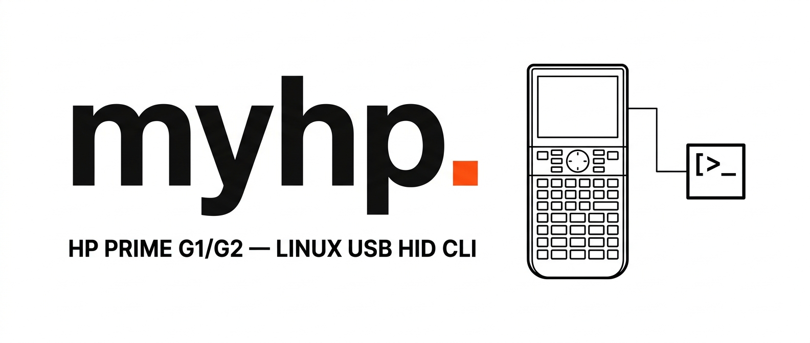

<div align="center">



<br />

**Controla tu calculadora HP Prime (G1 / G2) directamente desde la terminal o con tu agente de IA.**

[-111111?style=flat-square&logo=linux&logoColor=white)](#)
[](#)
[](#)
[](#)
[](LICENSE)

</div>

---

**myhp** es una interfaz de línea de comandos nativa en Linux para gestionar calculadoras **HP Prime (G1 / G2)** por USB (`hidraw`). Está diseñada para operar sin interfaces gráficas intermedias y permitir que tanto el usuario como un **agente de IA** transfieran contenido directamente desde la terminal:

- **Apuntes al instante:** genera resúmenes o formularios y envíalos directamente al catálogo de **Notas**.
- **Código sin fricción:** escribe programas en **PPL** o scripts en **MicroPython** y súbelos al catálogo de **Programas**.
- **Fórmulas e imágenes en resolución nativa:** empaqueta diagramas, tablas y capturas (`.png`, `.jpg`, `.bmp`) en una **App nativa** que abre directamente en la primera imagen con soporte de zoom y desplazamiento táctil.

> **Soporte de plataforma:** Exclusivo para **Linux** (cualquier distribución con soporte `hidraw` en el kernel: **NixOS, Arch, Ubuntu/Debian, Fedora**, etc.). **No hay soporte para Windows ni macOS por ahora.**

---

## Instalación

```bash
pip install -e .
```

Si tu usuario no tiene permisos de lectura/escritura sobre `/dev/hidraw*`, configura la regla `udev`:

```bash
sudo tee /etc/udev/rules.d/99-hp-prime.rules << 'EOF'
SUBSYSTEM=="hidraw", ATTRS{idVendor}=="03f0", ATTRS{idProduct}=="0441", MODE="0666"
SUBSYSTEM=="hidraw", ATTRS{idVendor}=="03f0", ATTRS{idProduct}=="1541", MODE="0666"
EOF
sudo udevadm control --reload-rules && sudo udevadm trigger
```

---

## Uso

> **Opción global:** añade `-d /dev/hidrawX` antes de cualquier subcomando para especificar un nodo USB manualmente (`myhp -d /dev/hidraw1 info`).

### 1. Conectar e inspeccionar la calculadora

Consultar modelo detectado, número de serie y versión de firmware:

```bash
myhp info
```

Listar los objetos almacenados en la memoria de la calculadora (`all`, `notes`, `prgms`, `apps`):

```bash
myhp list              # Todo el catálogo
myhp list notes        # Solo notas
myhp list prgms        # Solo programas PPL / MicroPython
myhp list apps         # Solo aplicaciones instaladas
```

---

### 2. Gestionar Notas (`note`)

Enviar un archivo de texto al catálogo de **Notas**:

```bash
myhp send note apuntes.txt
myhp send note apuntes.txt -n "Resistencia"     # Con nombre personalizado
```

Leer en la terminal o respaldar una nota de la calculadora en disco:

```bash
myhp get note "Resistencia"                     # Imprime en la terminal
myhp get note "Resistencia" -o backup.txt       # Guarda en un archivo local
```

Vaciar o eliminar una nota en la calculadora:

```bash
myhp delete note "Resistencia"
```

---

### 3. Enviar Programas PPL y MicroPython (`prgm`)

Subir código PPL (`.hpprgm` / `.txt`) o scripts de MicroPython (`.py`) al catálogo de **Programas**:

```bash
myhp send prgm vigas.txt                      # Usa el nombre del archivo (VIGAS)
myhp send prgm vigas.txt -n SOLVER_VIGAS      # Nombre personalizado en la Prime
myhp send prgm circuito.py -n CIRCUITO        # Script MicroPython
```

---

### 4. Enviar Fórmulas, Tablas e Imágenes (`gallery` / `image`)

#### Opción A — App de Galería nativa (recomendado)
Construye e instala una aplicación en **Apps** con tus imágenes originales (`.png`, `.jpg`, `.jpeg`, `.bmp`) sin pérdida de resolución. Al abrir la app en la calculadora, **muestra directamente la primera imagen** (`+`/`-` o pellizco táctil para zoom, arrastrar para desplazar, flechas `◄`/`►` para cambiar de imagen, `Esc` para abrir el selector de archivos):

```bash
# Enviar una sola imagen (ej. hoja de fórmulas)
myhp send gallery FORMULAS form.png

# Agrupar varias imágenes o directorios completos en una sola App
myhp send gallery FORMULAS form1.png form2.jpg ./tablas/

# Personalizar el icono de la App (32x32) o conservar el paquete .hpappdir en disco
myhp send gallery FORMULAS ./imagenes/ --icon icono.png
myhp send gallery FORMULAS ./imagenes/ --output ./build
```

#### Opción B — Imagen dibujada en código PPL (`image`)
Convierte un archivo `.png` ligero en un programa PPL autocontenido:

```bash
myhp send image grafico.png -n GRAFICO
myhp send image grafico.png -n GRAFICO --width 240 --height 180
myhp send image grafico.png -n GRAFICO --app --output ./build
```

---

## Licencia y Créditos

- Distribuido bajo la licencia **GNU GPL v3.0** (consulta el archivo [LICENSE](LICENSE)). El software se proporciona *"tal cual" (as-is)*, sin garantías de ningún tipo.
- Créditos a **Manuel Andrés Vélez** por la plantilla base del visor *Gallery v2.4.0* para HP Prime y a los proyectos de referencia de protocolo USB HID de la comunidad HP Prime.
